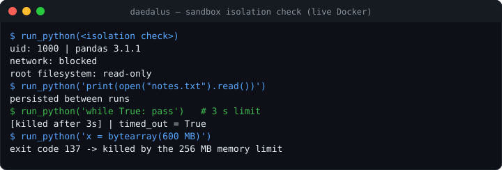
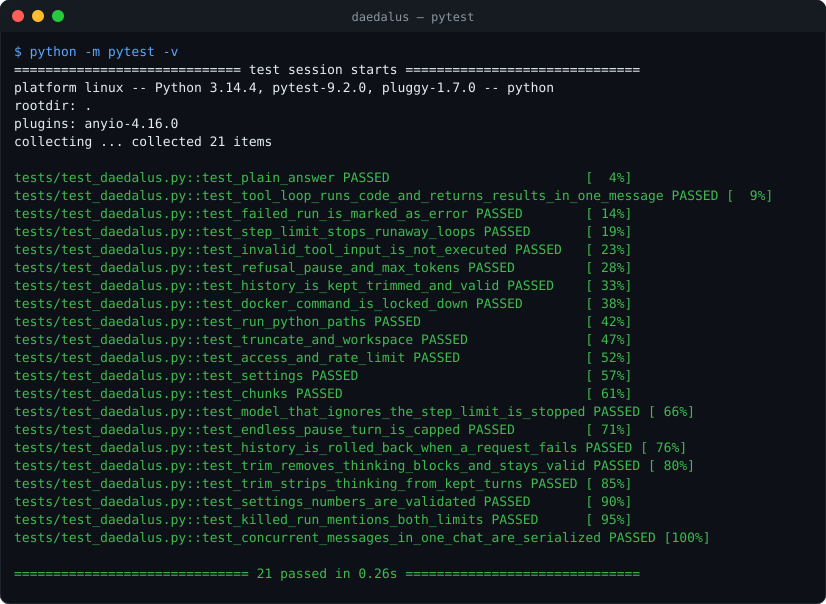
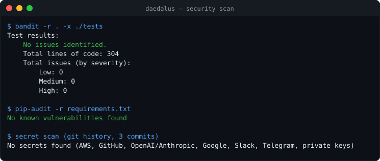

# Daedalus

[](https://github.com/fas0ftware/daedalus/actions/workflows/ci.yml)


A personal coding assistant on Telegram, powered by Claude. Ask a coding question or give it a task; when running code helps (calculations, checking a snippet, data wrangling) it executes Python in a **locked-down Docker sandbox** and answers with the verified result. It is the "heavy work" partner of the JUDA home assistant.



## How it works

```
Telegram ──► owner check, rate limit ──► Agent (Claude Messages API, tool use)
                                            │ run_python(code)
                                            ▼
                         docker run --network none --read-only --cap-drop ALL
                         --memory 256m --cpus 0.5 --pids-limit 64, non-root,
                         hard timeout, only this chat's folder mounted
```

- One conversation per chat (`/reset` starts over), trimmed so it never grows without bound.
- At most 8 sandbox runs per request, then Claude must answer with what it has.
- Long answers are split under Telegram's message limit.

## Security

- **Owner only:** messages from users not in `ALLOWED_USER_ID` are ignored and logged.
- **Sandbox:** no network, read-only root filesystem, no Linux capabilities, `no-new-privileges`, never root, 256 MB RAM (no swap), half a CPU, 64 processes, killed after the timeout; code goes in through stdin, never through a shell. The live check above shows the network blocked, the root filesystem read-only, an endless loop and a 600 MB allocation killed.
- **Limits:** 30 requests per hour per user (configurable), 8000-character messages, 20 kB code, 4 kB output per run.
- The bot token never appears in logs (the HTTP client's request logging is silenced). Keys live only in `.env` (git-ignored).

## Setup

```bash
python3 -m venv .venv && source .venv/bin/activate
pip install -r requirements.txt
docker build -t daedalus-sandbox sandbox/
cp .env.example .env      # TELEGRAM_TOKEN, ALLOWED_USER_ID, ANTHROPIC_API_KEY
python -m app.main
```

| Variable | Default | Meaning |
|---|---|---|
| `TELEGRAM_TOKEN` | – | from @BotFather |
| `ALLOWED_USER_ID` | – | your Telegram user id (comma-separated for several) |
| `ANTHROPIC_API_KEY` | – | Anthropic API key |
| `CLAUDE_MODEL` | `claude-haiku-5-5` | any current Claude model, e.g. `claude-opus-5-5` for harder tasks |
| `CLAUDE_EFFORT` | `medium` | `low` … `max`: more effort means deeper reasoning and more tokens |
| `DAEDALUS_REQUESTS_PER_HOUR` | 30 | rate limit |
| `DAEDALUS_SANDBOX_TIMEOUT` | 20 | seconds per code run |

## Tests

The agent loop is tested against a fake Claude client (tool calls, results returned together, error results, step limit, refusals, paused and truncated turns, history trimming) and the sandbox command and wrapper without Docker; the isolation check above was run against real Docker.

```bash
pip install -r requirements-dev.txt && python -m pytest -v
```





## Project layout

```
app/main.py               entry point
app/config.py             settings from .env
app/security.py           owner check, rate limit, input checks
app/sandbox.py            Docker sandbox runner
app/agent/core.py         Claude tool-use loop with the run_python tool
app/handlers/telegram.py  Telegram commands and messages
sandbox/Dockerfile        sandbox image (Python 3.12, numpy, pandas)
```

## Changelog

- **0.1.0** – First working version: Telegram bot, Claude agent with a sandboxed Python tool, owner-only access, rate limit, tests, CI. (Before: an empty skeleton.)

---

Part of the **FA Software** projects. Licensed under the [MIT License](LICENSE).
